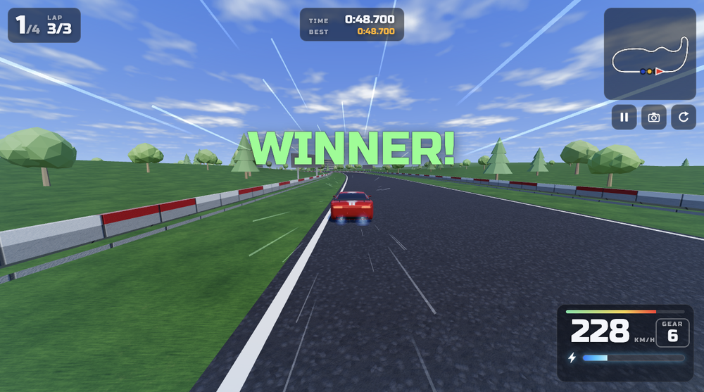
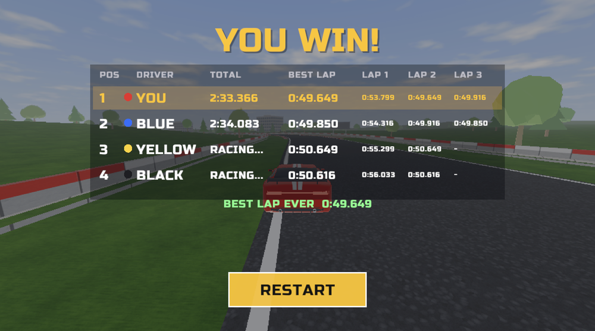

# One racing game, six ways

The same small arcade racing game was built five times from **one spec and one shared asset set**: plain
Three.js in the browser, a native port of that Three.js game, Bloom Engine's own APIs, a Three.js-plus-Bloom
hybrid, and Bevy in Rust. All five reached a playable 3-lap race. A sixth arm applied the native port to a real
open-source Three.js project instead; **that port is unfinished** (see D below). Every build was
done by the same AI coding agent (Claude Opus 5.5 in Claude Code), working from a fixed prompt with no human
code edits. This repository has the prompts, the code of every arm, the agents' own logs, the benchmarks and
a WebGPU spike.

Write-up: **[bloomengine.dev/blog/one-racing-game-six-ways](https://bloomengine.dev/blog/one-racing-game-six-ways)**

| Three.js in Chrome (arm A1) | Bloom, WebAssembly build of arm B |
|---|---|
|  |  |

## The setup

* **One asset set** ([`race-assets/`](race-assets)): a car with 4 colour variants, a 2.2 km circuit, scenery,
  sky, audio, UI icons and a manifest. Everything is generated by script, CC0, and validated with the Khronos
  glTF validator.
* **One game spec**, identical in every prompt ([`prompts/`](prompts)). It asks for 3 laps against 3 AI cars,
  plus nitro, drifting, no wall tunnelling, auto-reset, anti-shortcut checkpoints, a chase camera and a hood
  camera, keyboard, multi-touch and gamepad input, engine audio, a HUD with minimap, and a persisted best lap.
  The target is ≥ 55 fps on an iPhone 12-class phone. Every prompt has the same 12-point Definition of Done.
* **One agent per arm**, in its own fresh folder ([`setup.sh`](setup.sh)), with the docs of the tools it was
  allowed to use. Each arm kept a notes file and a friction or port log, written by the agent as it worked.

| Arm | What | Folder | Agent's own log |
|---|---|---|---|
| A1 | Three.js + TypeScript, browser | [`arms/a1-threejs-web`](arms/a1-threejs-web) | [NOTES](arms/a1-threejs-web/NOTES.md) |
| A2 | A1 compiled to native with Perry, running on Bloom's Three.js bridge, minimal changes | [`arms/a2-threejs-on-bloom`](arms/a2-threejs-on-bloom) | [PORT_LOG](arms/a2-threejs-on-bloom/PORT_LOG.md), [NOTES](arms/a2-threejs-on-bloom/NOTES.md) (summary of the log) |
| B | Bloom Engine's own APIs (rendering, Jolt physics, audio, UI), TypeScript compiled by Perry | [`arms/b-bloom-native`](arms/b-bloom-native) | [NOTES](arms/b-bloom-native/NOTES.md), [FRICTION](arms/b-bloom-native/BLOOM_FRICTION.md) |
| C | Hybrid: Three.js on the bridge for rendering, Bloom for physics, input, audio, HUD and storage | [`arms/c-hybrid`](arms/c-hybrid) | [NOTES](arms/c-hybrid/NOTES.md), [FRICTION](arms/c-hybrid/HYBRID_FRICTION.md) |
| D | Port of a real open-source Three.js project ([brunosimon/folio-2025](https://github.com/brunosimon/folio-2025) @ `70764a9`) | [`arms/d-folio-port`](arms/d-folio-port) | [INVENTORY](arms/d-folio-port/INVENTORY.md), [PORT_LOG](arms/d-folio-port/PORT_LOG.md) (**unfinished**) |
| E | Bevy 0.20.1 + avian3d 0.8.0, Rust | [`arms/e-bevy`](arms/e-bevy) | [NOTES](arms/e-bevy/NOTES.md), [FRICTION](arms/e-bevy/BEVY_FRICTION.md) |

Plus [`bench/`](bench) (sizes, startup, memory, and a browser head-to-head) and [`webgpu-spike/`](webgpu-spike)
(can unmodified three.js `WebGPURenderer` run when compiled by Perry?).

## What we found

1. **Bloom native (B) was the shortest path to a finished game.**
   * It took 1 h 28 min of wall-clock time, against about 2 h 14 min of active time for the hybrid and about
     3 h 09 min for Bevy.
   * It produced the smallest app: 71 MB on macOS and 76 MB on iOS, against 131 / 130 MB for Bevy.
   * A one-line change rebuilt in 5.4 s. Bevy took 10–12 s in dev and 5 min 46 s for the same change in a release build (thin LTO), and the hybrid
     took about 2.5 min, because it recompiles three.js on every build.
   * It ran at a steady 60 fps (vsync cap) on an iPhone 16 Pro on the Low preset.
   * It also made the agent read the most: 61.7M input tokens, the highest of any arm (see the costs table).
2. **Porting a normal Three.js game (A2) touched 2 lines of game code.** The port was 17 changes and 428 lines
   in total. The other 426 lines were adapters (222) and build/packaging (204). The 3D scene was not the
   bottleneck; the DOM/CSS HUD was.
   * On an iPhone 16 Pro the port ran at **38.4 fps** at first. The bridge's page engine spent 14–17 ms a frame
     on about 10,200 HUD draws.
   * A phone profile (Low preset, flat HUD stylesheet, page updates at 30 Hz) brought it to **59.5–59.8 fps**.
     None of the three was enough alone: Low alone gave 43.9 fps, and Low plus 30 Hz gave 49.4.
   * A Web Audio emulation bug also took the game from 57 to 35 fps after about 3 minutes.
3. **The same bridge gaps kept coming back** in A2, C and D:
   * `Points`, `Sprite`, `Line` and `InstancedMesh` are not drawn.
   * Normal and ORM maps are dropped, and so is the equirect sky background.
   * The 2D canvas is incomplete.
   * Three of A2's five most-wanted bridge improvements are on this list: drawing sprites, instancing, points and
     the sky; the 2D canvas; and Web Audio's event history. C's top request was a bridge feature matrix in the
     README, so that gaps like these are known up front instead of found by debugging.
4. **A real-world port (D) needed 0 lines of game code changed, and still did not fully arrive.**
   * folio-2025 needed an ~820-line Rapier→Jolt facade, patched copies of GSAP, Howler and three's TSL files,
     and a staged asset pipeline.
   * It surfaced Perry bugs that no small test had caught. Spreading arguments into the constructor of an
     imported class silently turned every TSL colour white.
   * Shader-driven content (TSL node materials, GPU compute particles, post-processing) cannot run on the
     bridge's renderer, so most of folio's look was lost.
   * The agent's port log stops before its required summary. Treat D as a stress test, not a finished port.
5. **Unmodified three.js `WebGPURenderer` compiled by Perry is correct, but too slow** ([spike](webgpu-spike/README.md)).
   * After two Perry fixes, the WGSL and the WebGPU call stream were byte-identical to Node's.
   * CPU time per frame was 3.4–5.0 ms against 0.33–0.37 ms in Node, about 10–12× slower.
   * About 62 % of frame time went to runtime slow paths. A missing-property lookup on a deep class chain costs
     39.8 ns in Perry against 0.7 ns in Node.
   * So providing `navigator.gpu` on wgpu is a viable route for Three.js on Bloom. The blocker is Perry's
     runtime speed, not correctness.
6. **On the web, Three.js is still clearly ahead of Bloom's WebAssembly build** ([results](bench/results/web-2026-11-09T18-20-01/results.md)).
   Both held 120 fps in Chrome on an M1 Max, but Bloom+WASM was worse on everything else:
   * It loaded in 3.44 s against 0.56 s.
   * It used 4.28 ms of page CPU per frame against 2.00 ms.
   * It used about 380 MB more RAM during a race.
7. **Bevy got there, but it was the heaviest build.**
   * A clean macOS release build (empty target directory, Bevy default features) took 11 min 27 s, and
     binaries were 95 MB.
   * Most of its friction was API renames between Bevy versions and ECS access conflicts reported without
     system names.
   * It never ran on a real phone; the only mobile number comes from the iOS simulator.

### Numbers side by side

| | A1 Three.js web | A2 port | B Bloom | C hybrid | E Bevy |
|---|---|---|---|---|---|
| Wall-clock time (agent) | not recorded | 2 h 57 min (≈2 h 38 working) | 1 h 28 min | 3 h 22 min (≈2 h 14 active) | ≈3 h 09 min |
| Model calls | 62 | 165 | 186 | 138 | 163 |
| Input tokens (incl. cache) | 12.0M | 36.3M | 61.7M | 37.4M | ≈44.2M |
| Output tokens | 175k | 112k | 184k | 156k | ≈214k |
| Clean release build | – | ≈2 min | 267 s (+282 s engine) | ≈2.5 min | 11 min 27 s |
| One-line rebuild | – | ≈16 s | 5.4 s | ≈2.5 min | 10–12 s dev / 5:46 release |
| macOS app | 36.5 MB web dist | 94 MB | 71 MB | 52 MB binary + 48 MB assets | 131 MB |
| iOS app | – | 103 MB | 76 MB | ≈107 MB | 130 MB |
| iPhone 16 Pro fps | – | 59.5–59.8 (Low preset + flat HUD + 30 Hz page; 38.4 without) | 60 (vsync cap) | 59.96 avg, min 55.6 | not run on a device |
| Friction / port-log entries | – | 17 | 29 | 16 | 14 |

The asset set itself took 63 model calls, 10.4M input and 191k output tokens, and about 34 min
([BUILD_TOKENS](race-assets/BUILD_TOKENS.md)). D is not in this table: its port is unfinished and it has no
time or token record.

Sources for every number: the arm's own NOTES, FRICTION, PORT_LOG and TOKEN_USAGE files, and [`bench/results`](bench/results).
Token counts are sums of the per-call `usage` records in each Claude Code session log.

## Read this before quoting any number

* **Arm D is unfinished.** The folio-2025 port stops before its required summary and never states whether the
  game is playable; it is a map of what breaks, not a result to compare.
* **One run per arm.** These are anecdotes with numbers attached, not statistics. Agents make different
  choices on a second run.
* **The builder was an AI agent, not a team of humans.** The numbers say as much about how well each stack's
  docs and errors guide an agent as about the stack itself. Every arm got the same model and the same spec,
  but different docs.
* **No iPhone 12-class device was tested.** The spec's 55 fps target was measured only on an iPhone 16 Pro (B,
  C, A2), in the iOS simulator (E), or on desktop Chrome with throttling (A1).
* **Not verified with a real hand on the device:** multi-touch, gamepad, and engine audio by ear (E's audio
  was never listened to).
* **The browser benchmark compares the apps as built, not the engines.** Bloom's web build had no tyre smoke
  or skid marks. The native size/startup run was a single launch on a busy machine.
* **The toolchain moved during the experiment.** B used Perry 0.5.1664. C pinned 0.5.1663, because 1664
  miscompiled three.js. A2 built Perry from `main`.
* **Gaps in the logs.** A2's agent never updated its `NOTES.md`, so the file first published here was an
  unchanged copy of A1's. On 2026-11-26 it was replaced with a short summary written from A2's `PORT_LOG.md`,
  which remains the agent's own record; the original copy is in git history (commit `5425ad5`). C
  did not report its app sizes or an incremental build time; the numbers above come from `du`.

## Repository layout and what was removed

* `race-assets/`: generator scripts plus the generated assets. Run `make assets` to rebuild them.
* `arms/*/assets` is a symlink to `race-assets/assets`, so the 48 MB asset set is stored once.
* Removed from every arm: build output (`dist/`, `.app` bundles, binaries), `node_modules`, logs, iOS
  provisioning profiles, and the original git history.
* Signing identities and local paths were replaced with placeholders (`YOUR NAME (TEAMID)`, `$HOME/projects/...`,
  `<racer>/...`). To build the native arms you need Perry, Bloom Engine, and your own Apple signing setup; see
  each arm's NOTES.
* `arms/d-folio-port/` holds **only our port work** (`bloom/` adapters, build scripts, the inventory and the
  port log), plus the upstream MIT licence. To reproduce it, check out folio-2025 at `70764a9` and copy
  `bloom/` into it. folio's own models, textures and music are not redistributed here.

## Licence

* Code: MIT, see [LICENSE](LICENSE).
* `race-assets/assets`: CC0-1.0, except the Russo One font (SIL OFL 1.1, licence alongside).
* `arms/d-folio-port` is a derivative of folio-2025: MIT, © 2025 Bruno Simon (see its `license.md`).
